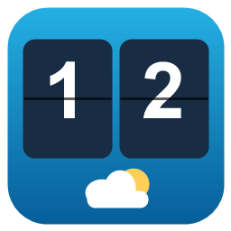
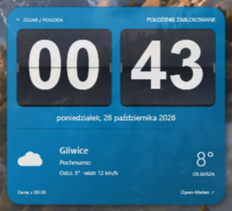
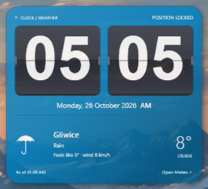

# Zegar HTC — widżet Windows



Natywny widżet WPF dla Windows 10/11 x64, inspirowany klapkowym zegarem HTC Sense. Godzina i minuty w formacie 12 h (AM/PM) lub 24 h, interfejs i data po polsku lub angielsku oraz aktualna pogoda z Open-Meteo. Czas i data używają strefy czasowej Windows; miejscowość pogody wybiera się niezależnie.



English · 12H (AM/PM):



## Pobieranie

- [Gotowy Zegar.exe — Windows x64](https://github.com/zetmar-collab/Zegar/releases/latest/download/Zegar.exe)
- [Pakiet ZIP 1.4.0 ze skryptem instalacyjnym](https://github.com/zetmar-collab/Zegar/releases/download/v1.4.0/Zegar-1.4.0-win-x64.zip)
- [Mniejszy ZIP — wymaga .NET 8 Windows Desktop Runtime x64](https://github.com/zetmar-collab/Zegar/releases/download/v1.4.0/Zegar-1.4.0-win-x64-framework.zip)
- [Wszystkie wydania](https://github.com/zetmar-collab/Zegar/releases)

EXE można uruchomić bezpośrednio. Aby dodać skróty i autostart, pobierz ZIP, rozpakuj cały pakiet i uruchom poniższe polecenie w jego folderze. Kod źródłowy znajduje się w repozytorium, a pliki binarne w sekcji **Releases**. Sumy SHA-256 są dołączone do wydania w pliku `SHA256SUMS.txt`.

## Uruchomienie i instalacja

Gotowy plik: `publish/Zegar.exe`. Pakiet jest samodzielny: nie wymaga instalowania .NET ani klucza API. Wymaga Internetu do pobierania pogody. Pierwsze uruchomienie samodzielnego pliku może potrwać dłużej, ponieważ .NET rozpakowuje biblioteki.

Instalacja dla bieżącego użytkownika i skróty na Pulpicie oraz w menu Start. Pierwsza instalacja włącza autostart, a aktualizacja zachowuje dotychczasowy wybór:

```powershell
powershell -NoProfile -ExecutionPolicy Bypass -File .\scripts\Install.ps1
```

Opcje `-EnableAutostart` i `-DisableAutostart` jawnie zmieniają autostart; `-NoLaunch` pomija uruchomienie po instalacji.

Skrypt kopiuje program do `%LOCALAPPDATA%\Programs\ZegarHTC` i uruchamia widżet. Nie wymaga administratora. Domyślna pogoda: **Warszawa** — zmień miejscowość przez PPM → Ustawienia → Szukaj → wybierz wynik → Zapisz ustawienia. Autostart można wyłączyć i ponownie włączyć w ustawieniach; wpis znajduje się w `HKCU\Software\Microsoft\Windows\CurrentVersion\Run\ZegarHTC`. Systemowy Menedżer zadań może dodatkowo wyłączyć uruchamianie tego wpisu.

## Obsługa

- **PPM → Ustawienia → Język / Language**: Polski lub English. Język w ustawieniach zmienia się od razu; zastosowanie do widżetu i zapis następują po kliknięciu „Zapisz ustawienia”. Anulowanie zachowuje dotychczasowy język.
- **Format zegara**: 24H lub 12H (AM/PM). W 12H północ to 12:00 AM, a południe 12:00 PM. AM/PM widać obok daty. Domyślnie zachowane są polski język i 24H, również po aktualizacji starszej wersji.

- Przeciągnij widżet lewym przyciskiem myszy. Położenie jest zapamiętywane.
- **Prognoza na 3 dni**: temperatury min./maks., szansa opadów, wschód i zachód słońca w strefie miejscowości. Dane są dostępne także z lokalnego cache.
- Prawy przycisk: **Ustawienia**, **Zablokuj położenie**, **Zawsze na wierzchu**, **Odśwież widżet**, **Uruchom ponownie**, **Zamknij**.
- Ustawienia: miejscowość, rozmiar 65–160%, osobna widoczność tła i tekstu 40–100%, pogoda co 5–120 minut, autostart, blokada i zawsze na wierzchu. Podgląd uwzględnia gradient i ostrzega o niskim kontraście.
- Kolor tła: **PPM → Ustawienia → Kolor widżetu → Wybierz kolor… → Zapisz ustawienia**. Dostępny jest dowolny kolor z systemowej palety oraz przycisk „Domyślny”. Kolor jest zapamiętywany; napisy automatycznie zmieniają się na jasne lub ciemne. W trybie automatycznego koloru czcionki karty godzin zachowują jasne tło i ciemne cyfry.
- Czcionka: **PPM → Ustawienia → Czcionka widżetu / Kolor czcionki → Zapisz ustawienia**. Lista zawiera czcionki zainstalowane w Windows i opcję „Domyślna (HTC)”. Podgląd pokazuje wybór przed zapisaniem. Wybrany kolor dotyczy cyfr, daty i opisów pogody; przy jasnych cyfrach karty automatycznie ciemnieją. „Automatyczny” przywraca dobór koloru do tła. Anulowanie nie zapisuje zmian wyglądu.
- Okno ustawień jest modalne: pozostaje nad widżetem, blokuje jego obsługę i przyciemnia go. Zegar i pobieranie pogody nadal działają. Można zmieniać rozmiar okna ustawień lub przewijać opcje; Escape anuluje edycję.
- Zasobnik systemowy: pokaż zegar, ustawienia, odświeżanie i zamknięcie.
- **Restart zegara HTC** na Pulpicie uruchamia `Zegar.exe --restart` i potrafi zamknąć zawieszony proces z tej samej ścieżki. Zwykłe uruchomienie przywołuje działający zegar lub jego otwarte ustawienia.
- W trybie bez „Zawsze na wierzchu” inne okna mogą zasłonić widżet. Jest to osobne okno bez ramki, nie rozszerzenie powłoki Explorer. Windows może ukryć je po użyciu „Pokaż pulpit”; przywróć je z zasobnika.

Ustawienia są zapisywane atomowo w `%LOCALAPPDATA%\ZegarHTC\settings.json`, z kopią `.bak`. Przy uszkodzeniu program próbuje odzyskać kopię i zachowuje uszkodzony plik. Błąd zapisu pozostawia edytor otwarty. Po zmianie monitorów lub DPI pozycja jest korygowana; zbyt duży widżet jest dopasowywany do ekranu.

Przy błędzie połączenia pozostają ostatnie dane z oznaczeniem problemu; następna próba następuje po 2 minutach. Dane starsze niż 45 minut są oznaczane jako starsze. Cache pogody jest utrwalany między uruchomieniami w podfolderze `weather-cache`, osobno dla współrzędnych. Zmiany wyglądu nie kasują danych ani statusu offline. Automatyczne odświeżanie działa niezależnie od sekundowego timera zegara.

## English

HTC-style desktop clock for Windows 10/11 x64 with Open-Meteo weather. No .NET installation or API key required. Download `Zegar.exe` from [Releases](https://github.com/zetmar-collab/Zegar/releases/latest), or extract the complete ZIP and run `scripts/Install.ps1` to add shortcuts and Windows startup.

Right-click the widget → **Ustawienia** → **Język / Language** → **English** → **Save settings**. Choose **24H** or **12H (AM/PM)** using **Clock format**. The selected language applies to the widget, settings, menus, dates and weather descriptions. System colour pickers and Windows-generated error details follow the Windows language. Location names use Open-Meteo translations where available. Clock time follows your Windows time zone. Settings, colours, fonts, position and startup preferences are retained during updates.

## Budowanie i testy

Workflow GitHub Actions buduje Windows x64 i uruchamia 59 testów lokalnych. Dodatkowe 3 testy `--live` sprawdzają API. Szczegóły: [VERIFICATION.md](VERIFICATION.md).

Wymagania deweloperskie: Windows, .NET SDK 8 lub nowszy z obsługą .NET 8. Repozytorium nie używa zewnętrznych pakietów NuGet.

```powershell
dotnet build .\Zegar.csproj -c Release
dotnet run --project .\tests\Zegar.Checks.csproj
dotnet run --project .\tests\Zegar.Checks.csproj -- --live
dotnet run --project .\tests\UiChecks\Zegar.UiChecks.csproj -c Release
powershell -NoProfile -ExecutionPolicy Bypass -File .\tests\Installer.Checks.ps1
powershell -NoProfile -ExecutionPolicy Bypass -File .\scripts\Build.ps1
powershell -NoProfile -ExecutionPolicy Bypass -File .\scripts\Build.ps1 -FrameworkDependent
powershell -NoProfile -ExecutionPolicy Bypass -File .\scripts\Package.ps1
```

Testy obejmują zapis i uszkodzenie ustawień, walidację, parsowanie danych i kodów WMO, błędy HTTP/JSON, anulowanie oraz opcjonalny test rzeczywistych endpointów. Sprawdzenie UI: menu PPM, wyszukiwanie i wybór miejscowości, zapis, przeciąganie i blokada, zawsze na wierzchu, rozmiar, odświeżenie, ponowny start, obecność wpisu autostartu. Pełne uruchomienie podczas logowania wymaga następnego logowania użytkownika.

## Architektura

```text
App + InstanceActivation (jedna instancja, przywołanie przez named pipe, restart)
 └─ ClockWindow (WPF, timery, menu, zasobnik)
     ├─ SettingsWindow (wyszukiwanie i preferencje)
     ├─ ForecastWindow (prognoza 3 dni)
     ├─ WeatherState + WeatherCacheStore (stan i cache na dysku)
     ├─ WindowPlacement (monitory i DPI)
     ├─ WeatherService → HTTPS → Open-Meteo Forecast / Geocoding
     ├─ SettingsStore → lokalny JSON
     └─ Autostart → rejestr bieżącego użytkownika
```

`Core.cs` zawiera modele, walidację, zapis i klienta HTTP. `Platform.cs` obsługuje autostart. Pliki XAML i odpowiadający im C# definiują widoki. `scripts/` zawiera budowanie i instalację; `tests/` — samodzielny zestaw testowy. Nie ma serwera ani bazy danych. Asynchroniczne pobieranie ma limit 18 sekund i anulowanie poprzedniego żądania. Nie są pobierane dane GPS ani IP użytkownika; API otrzymuje wybraną nazwę miejscowości i jej współrzędne.

## Ikona i podpis wydawcy

Własna ikona jest osadzona w EXE i używana przez okna oraz zasobnik. Pliki `assets/Zegar.ico` i `assets/Zegar.png` odtwarza `scripts/Create-Icon.ps1`.

Wydanie 1.4.0 pozostaje **niepodpisane**. Przygotowano `scripts/Sign.ps1`, który po uzyskaniu certyfikatu wydawcy podpisuje EXE SHA-256 ze znacznikiem czasu i weryfikuje wynik. Instrukcja: [docs/SIGNING.md](docs/SIGNING.md).

## Źródła danych i licencje

Pogoda: [Open-Meteo](https://open-meteo.com/), [Forecast API](https://open-meteo.com/en/docs), [Geocoding API](https://open-meteo.com/en/docs/geocoding-api). Dane pogodowe: [CC BY 4.0](https://creativecommons.org/licenses/by/4.0/), dane lokalizacyjne pochodzą z GeoNames. Bezpłatny publiczny endpoint jest przeznaczony do użycia niekomercyjnego zgodnie z [warunkami Open-Meteo](https://open-meteo.com/en/terms). Program zawiera widoczne przypisanie źródła. Własny kod: MIT; projekt nie jest powiązany z HTC i nie używa jego zasobów graficznych.

## Odinstalowanie

Wyłącz autostart w ustawieniach i zamknij zegar. Usuń folder `%LOCALAPPDATA%\Programs\ZegarHTC` i skróty „Zegar HTC” / „Restart zegara HTC”. Opcjonalnie usuń `%LOCALAPPDATA%\ZegarHTC`, aby skasować preferencje. Projekt nie dodaje usług ani zadań Harmonogramu.

